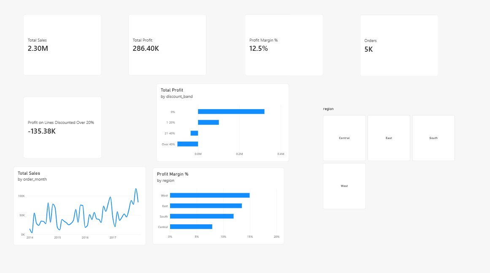
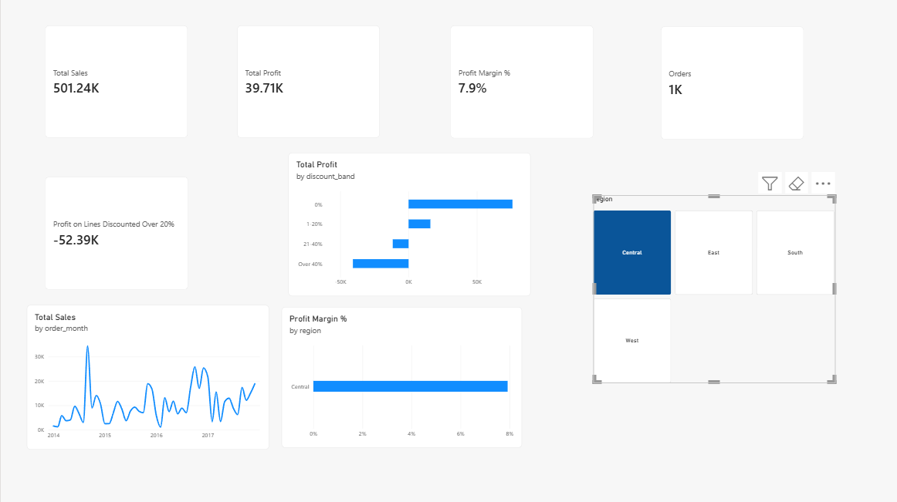

# E-Commerce Sales & Profitability Performance Dashboard

An end-to-end business intelligence and analytics project analyzing e-commerce sales, profit margins, discount erosion, and regional performance. Built using **Python (ETL & SQL feature engineering)** and **Power BI (Interactive Dashboard & DAX modeling)**.

---

## 📊 Dashboard Preview



*Central Region Deep-Dive:*


---

## 🎯 Executive Summary & Key Findings

1. **Discounting Erodes Profitability**:
   - Products sold with discounts **> 20%** consistently produce negative profit margins, despite driving sales volume.
   - Low discount tiers (0–20%) generate healthy margins of ~15–30%, whereas heavy discounting (over 40%) results in severe net losses across multiple categories.

2. **Regional Margin Disparities**:
   - The **Central region** exhibits the lowest overall profit margins, primarily driven by aggressive discounting strategies in Furniture and Office Supplies.
   - In contrast, the **West and East regions** deliver strong revenue and stable margins.

3. **Sub-Category Margin Traps**:
   - **Tables**, **Bookcases**, and **Supplies** represent margin-negative sub-categories requiring price discipline and discount caps.
   - **Technology** (Copiers, Phones, Accessories) drives both top-line revenue and bottom-line profit.

4. **Seasonal Trends**:
   - Strong revenue concentration in **Q4 (October – December)**, driven by holiday sales and promotional campaigns.

---

## 🏗️ Architecture & Data Pipeline

```
Raw Superstore Data (CSV)
         │
         ▼
 Python ETL Pipeline (`etl.py`)
   ├── Date parsing & validation
   ├── Data type cleaning & missing value checks
   ├── Feature engineering:
   │     • Discount bands ('0%', '1-20%', '21-40%', 'Over 40%')
   │     • Profit Margin %
   │     • Year & Month extraction
   └── SQLite Database storage (`superstore.db`)
         │
         ▼
 Cleaned Dataset (`orders_clean.csv`)
         │
         ▼
 Power BI Interactive Report (`sales_dashboard.pbix`)
   ├── KPI Cards (Total Sales, Total Profit, Margin %, Total Orders)
   ├── Dynamic Date & Regional Slicers
   ├── Discount vs Profit Sensitivity Analysis
   └── Sub-Category Performance Breakdowns
```

---

## 📁 Repository Structure

```
├── data/
│   └── superstore.csv            # Raw dataset
├── etl.py                        # Python data ingestion, cleaning & SQL analysis pipeline
├── orders_clean.csv              # Processed and transformed dataset for Power BI
├── sales_dashboard.pbix          # Interactive Power BI report file
├── superstore.db                 # SQLite database generated by ETL
├── dashboard.png                 # Executive dashboard screenshot
├── dashboard_central.png         # Regional deep-dive screenshot
├── .gitignore                    # Git ignore file
└── README.md                     # Project documentation
```

---

## 🚀 How to Run & Reproduce

### 1. Run Data Pipeline (Python & SQL)
Ensure you have Python installed with `pandas`:
```bash
pip install pandas
python etl.py
```
This script will:
- Ingest raw data from `data/superstore.csv`.
- Clean and transform columns.
- Execute SQL queries to analyze regional and category margins.
- Export `orders_clean.csv` and `superstore.db`.

### 2. View Power BI Dashboard
Open [`sales_dashboard.pbix`](./sales_dashboard.pbix) using [Microsoft Power BI Desktop](https://powerbi.microsoft.com/desktop/).

---

## 🛠️ Tech Stack
- **Python**: Pandas, Data Cleaning, Feature Engineering
- **SQL / SQLite**: Data modeling and aggregated margin queries
- **Power BI / DAX**: Interactive visual storytelling, KPI cards, and dynamic filtering
